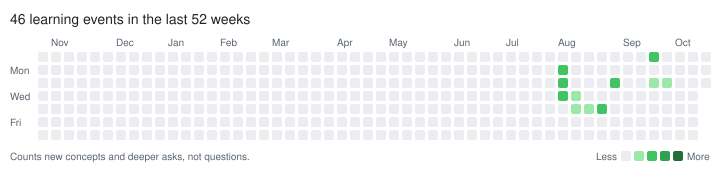

# asktrace

**Measure how your knowledge accumulates from the questions you ask LLMs.**

You ask Claude, ChatGPT or Claude Code dozens of questions a day. asktrace reads those
transcripts, tags every question with the concepts it touches and how deep it goes, and
tells you what you are learning, what is sticking, and what you keep asking again.

```
| Metric                                     | Value |
|--------------------------------------------|-------|
| Questions                                  | 412   |
| Distinct concepts                          | 187   |
| Accumulated knowledge (Σ mastery)          | 96.4  |
| New concepts / active week                 | 14.4  |
| Re-ask rate (no deeper)                    | 21.3% |
| Deepening rate (revisits that went deeper) | 58.0% |

## Asked again without going deeper (forgetting signal)
| Concept              | Asks | Shallow re-asks | Max depth |
| docker volume mount  | 3    | 2               | 2         |
```

Works offline with a heuristic tagger. For canonical concept names across languages and
phrasings, tag with Claude: through the Claude Code CLI on a Pro/Max subscription, or through
the API with a key.

## Install

```bash
pip install asktrace            # offline heuristic tagger
pip install 'asktrace[claude]'  # + Claude tagger
```

Or from source: `uv sync --extra dev`.

## Quick start

```bash
# 1. Pull your questions in (all idempotent; re-run on fresh exports any time)
asktrace ingest claude-code                      # ~/.claude/projects/**/*.jsonl
asktrace ingest claude-export conversations.json # claude.ai → Settings → Export data
asktrace ingest chatgpt-export conversations.json
asktrace ingest jsonl my_questions.jsonl         # {"text": ..., "asked_at": "ISO8601"}

# 2. Tag them
asktrace tag                                     # offline heuristic
asktrace tag --tagger claude-code                # Claude subscription via `claude -p`, no API key
asktrace tag --tagger claude                     # Anthropic API (ANTHROPIC_API_KEY)

# 3. Look
asktrace report
asktrace report --since 2026-09-01 --format json
```

Try it on the bundled sample without touching your own data:

```bash
asktrace --db /tmp/demo.db ingest jsonl examples/sample_questions.jsonl
asktrace --db /tmp/demo.db tag
asktrace --db /tmp/demo.db report
```

## Run it automatically in Claude Code

`asktrace hook` reads a [Claude Code hook](https://code.claude.com/docs/en/hooks) payload
from stdin and ingests the one transcript it names (`transcript_path`). Add a `SessionEnd`
hook to `~/.claude/settings.json` (all projects) or a project's `.claude/settings.json`;
asktrace does not edit these files for you:

```json
{
  "hooks": {
    "SessionEnd": [
      {
        "hooks": [
          { "type": "command", "command": "asktrace hook", "timeout": 10 }
        ]
      }
    ]
  }
}
```

- `asktrace` has to be on the `PATH` Claude Code sees. If it is not, use the full path
  from `which asktrace`. The same goes for `ASKTRACE_DB`: Claude Code started from the
  desktop app or an IDE may not see variables set in your shell profile, so a custom
  database belongs in the command itself (`asktrace --db ~/notes/asktrace.db hook`).
- SessionEnd hooks share a 1.5-second budget unless a hook sets its own `timeout`, so the
  snippet sets 10 seconds. Ingesting one transcript usually takes well under a second.
- The hook always exits 0 and prints nothing on success. Errors go to stderr only, so a
  bad payload or a locked database never turns into a hook error in your session. To debug,
  run it by hand: `echo '{"transcript_path": "/path/to/session.jsonl"}' | asktrace hook`.
- The hook does not tag. Tagging with `--tagger claude-code` would launch `claude -p`
  while Claude Code is shutting down, so run `asktrace tag --tagger claude-code` when you
  look at your report. `asktrace hook --tag heuristic` tags the session's questions
  offline instead, but those questions keep heuristic tags: `asktrace tag` only fills in
  untagged ones.
- Ingest is idempotent, so the same command also works as a `Stop` hook (after every
  response). SessionEnd is enough for most people. Claude Code writes the transcript
  asynchronously, so the last message of a session can be missing when the hook runs;
  `asktrace ingest claude-code` picks up anything a hook missed.

## Knowledge grass

A GitHub-style contribution graph of what you learned, one square per day:

```bash
asktrace grass --out grass.svg                     # last 52 weeks, light theme
asktrace grass --out grass-dark.svg --theme dark
asktrace grass --weeks 26 > grass.svg              # no --out: SVG on stdout
asktrace grass --end 2026-06-30 --out h1.svg      # a window ending on another day
```



A square's shade is the day's **learning events**, not its question count:

- +1 for each concept you asked about for the first time
- +1 for each concept you asked about at a deeper level than ever before
  (define → apply → reason → debug → design)
- 0 for asking about a concept again at the same or a lower depth, however many times

Splitting one question into five, or asking the same docker question every month, does not
make a day greener. A concept is worth at most five events in total. The shades are fixed:
1-4, 5-9, 10-19 and 20+ events. Days follow your local time zone, and only tagged questions
are drawn, so run `asktrace tag` first. The example above is the bundled sample tagged
with the offline heuristic tagger, drawn with `--end 2026-10-20`.

The SVG contains dates and counts only: no concept names, domains or question text.

### Put it on your GitHub profile

Your profile README lives in the repository named after your username. Write both themes
into a clone of it and let GitHub pick the one that matches the viewer:

```bash
asktrace grass --out ~/src/<username>/asktrace-grass.svg
asktrace grass --out ~/src/<username>/asktrace-grass-dark.svg --theme dark
```

```html
<picture>
  <source media="(prefers-color-scheme: dark)" srcset="asktrace-grass-dark.svg">
  
</picture>
```

Commit both SVGs and push. The graph changes only when you regenerate and push again;
nothing reads your database except asktrace on your own machine.

## What it measures

Each question gets **concepts** (e.g. `prompt caching`, `git rebase`), a **domain**, and a
**depth** from 1 to 5:

| depth | you asked…                              |
|-------|-----------------------------------------|
| 1     | what is X?                              |
| 2     | how do I use X?                         |
| 3     | why X? X vs Y?                          |
| 4     | X fails with …, why?                    |
| 5     | how should I design / trade off X?      |

From those, per concept and per week:

- **Acquisition**: concepts you asked about for the first time.
- **Deepening**: revisited concepts whose questions got deeper over time.
- **Forgetting signal**: concepts you re-asked at the same or lower depth.
- **Mastery** (0-1): depth reached × evidence from separate days × 90-day recency decay.
  One deep question earns half; coming back on other days earns the rest.
- **Accumulated knowledge**: Σ mastery. Watch the slope.

The reasoning behind each number is in [docs/DESIGN.md](docs/DESIGN.md). They are
heuristics about what you *asked*, not a test of what you know.

## Privacy

Everything stays on your machine in one SQLite file (`~/.asktrace/asktrace.db`, or
`--db` / `ASKTRACE_DB`). Question text leaves your machine only when you choose a
Claude-backed tagger (`--tagger claude-code` or `--tagger claude`). The `grass` SVG holds
only dates and counts, so it is the one output meant to be shared.

## Development

```bash
uv sync --extra dev
uv run pytest -q
uv run ruff check .
```

Adding a source: subclass `asktrace.sources.base.Source`, yield `Question`s, register it in
`asktrace/sources/__init__.py`. Adding a tagger: subclass `asktrace.tagger.base.Tagger`.

## License

MIT
