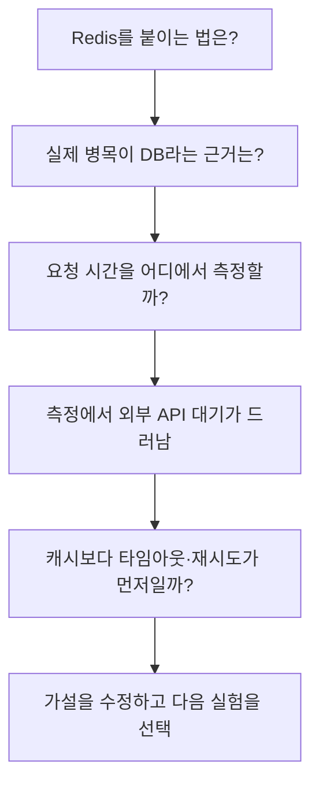

# 질문 여정과 사고의 변화를 기록하는 asktrace

이 문서는 지식 잔디·자동 수집 제안과 “무엇을, 어떻게, 연쇄적으로 묻는가”라는
제품 목표를 발전시킨 제안이다. 자동 수집 훅, SVG 잔디, Codex 수집에 더해
세션 기반 여정 조회, 질문의 수동 그룹·분리, 세 항목의 사용자 회고, 날짜를 눌러 기록을
보는 개인 HTML 내보내기는 구현했다. 아래의 질문 관계 추론, 자동 판단 변화 분석,
다음 질문 추천, 이해 검증은 아직 구현하지 않았다.
참고로 전달된 [교보문고 링크](https://product.kyobobook.co.kr/detail/S000211925133)는
접근 제한으로 내용을 확인하지 못했다. 책의 구체적인 주장이나 이론을 인용하지 않는다.

## 핵심 사용자 경험

**“내 질문이 어떻게 이어졌고, 어떤 근거로 생각을 바꿨으며, 다음에는 무엇을 확인하면
좋을지 보여준다.”**

하루가 끝나면 잔디 한 칸을 누른다. 오늘의 질문 여정이 나오고, 아직 확인하지 않은
가정 하나와 남겨둘 결정 하나가 보인다. 다음 작업에서는 그 결정을 다시 찾거나
미해결 질문을 이어갈 수 있다.

처음에는 Codex·Claude Code 사용자의 실제 작업 하나를 대상으로 만든다.
이후 ChatGPT·Claude의 학습·글쓰기·의사결정 대화에도 같은 구조를 적용할 수 있다.
일상적인 구문 확인이나 단순 위임에는 짧은 답 하나로 끝나는 것이 적절할 수 있다.
긴 질문 사슬 자체를 목표로 두지 않는다.

## 1. 질문을 목적이 있는 여정으로 묶기

분석 단위는 질문 한 개뿐 아니라 하나의 목표를 가진 질문 묶음이다.
같은 세션 안에서도 주제가 바뀔 수 있고, 하나의 목표가 여러 도구와 날짜에 걸칠 수도 있다.
우선 같은 세션에서 후보를 만들고, 여러 세션을 연결하는 것은 사용자가 확인한다.

각 질문에는 난이도와 별개로 역할을 붙인다.

| 질문의 역할 | 예시 |
| --- | --- |
| 목표 구체화 | “여기서 느리다는 것은 어느 요청의 지연을 말하나?” |
| 개념 확인 | “캐시 적중률은 무엇인가?” |
| 가정 드러내기 | “DB가 원인이라는 근거가 있나?” |
| 비교 기준 세우기 | “지연과 데이터 신선도 중 무엇이 더 중요한가?” |
| 반례·경계 확인 | “캐시를 넣으면 오히려 틀리는 경우는?” |
| 검증 설계 | “어떤 측정 결과면 이 가설을 버릴까?” |
| 새 맥락에 적용 | “이 원리를 다른 서비스에도 적용할 수 있나?” |
| 판단 정리 | “지금 결정할 수 있는 것과 아직 모르는 것은?” |

이는 고정된 단계나 높은 점수 순서가 아니다. 구현, 학습, 탐색 등 목적에 따라 필요한
질문의 역할이 다르다. 역할은 복수로 붙을 수 있고 사용자가 수정할 수 있어야 한다.

설명용 여정:

관찰 가능한 변화는 질문 수가 아니라, 이 사례에서 사용자가 문제 정의를 수정했다는
것이다. 그 변화가 타당한지는 측정 결과와 사용자의 확인이 필요하다.

## 2. 시작 질문과 마지막 판단을 나란히 보여주기

“Redis를 어떻게 붙이지?”로 시작해 “병목부터 측정해야 한다”로 끝났다면,
처음의 가정, 판단을 바꾼 발언·관찰, 최종 결정을 연결한 카드로 남긴다.

- 무엇을 하려 했는가?
- 어떤 가정을 갖고 시작했는가?
- 어떤 근거를 만나 무엇을 바꿨는가?
- 다음에는 무엇을 먼저 확인할 것인가?

단순히 표현만 바뀐 것과 가정·기준·행동이 바뀐 것을 구분한다.
AI가 제시한 결론과 사용자가 채택한 결론도 구분한다.
사용자 확인이나 행동 근거가 없으면 “AI가 제안함 / 채택 여부 미확인”으로 남긴다.

## 3. 빠진 질문 하나를 제안하기

세션 종료 후 선택형 회고에서 다음 질문을 최대 하나 제안한다.
실시간 개입은 사용자가 요청했을 때 제공하는 것이 초기 기본값으로 적절하다.

| 관찰한 대화 | 제안 후보 | 제안 근거 |
| --- | --- | --- |
| 해결책은 여럿인데 선택 기준이 없다 | “무엇을 만족하면 성공인가?” | 완료 조건을 설명한 발언을 찾지 못함 |
| 원인을 단정하고 구현에 들어갔다 | “어떤 관찰이면 이 원인이 아니라고 판단할까?” | 원인 후보는 있으나 검증 근거가 없음 |
| AI 설명을 받은 뒤 이해 여부가 불분명하다 | “이 원리를 처음 보는 사례에 적용하면?” | 사용자가 학습을 목표로 선택함 |
| 비교가 계속되지만 결정을 못 한다 | “지금 결정에 꼭 필요한 미확인 정보는 하나인가?” | 선택 기준은 있지만 필요한 정보가 미정 |

“발견하지 못했다”는 것은 “사용자가 생각하지 않았다”는 뜻이 아니다.
제안에는 근거 대화와 “이미 확인함 / 관련 없음 / 도움이 됨”을 붙인다.
목표가 달성됐으면 “더 묻지 않고 실행해도 됨”도 적절한 결과다.

## 4. 미해결 질문함

대화 종료를 문제 해결로 간주하지 않는다. 사용자가 남기고 싶은 질문에 다음 상태를 둔다.

- 해결: 근거가 되는 답변·실험·결정 연결
- 검증 대기: 무엇을 보면 판단할 수 있는지 기록
- 보류: 다시 볼 조건 기록
- 목표 변경: 더 이상 풀 필요가 없어진 이유 기록

며칠 뒤 같은 주제가 나오면 이전의 미해결 지점부터 이어갈 수 있게 한다.
단순히 “세 번째 질문입니다”라고 지적하는 것보다
“지난번에는 A를 의심했고 B는 아직 측정하지 않았습니다”가 구체적이다.
명시적인 관련 근거가 없는 다른 프로젝트의 질문은 자동으로 합치지 않는다.

## 5. 설명·예측·적용으로 이해를 확인하기

직접 학습하려는 사용자는 선택적으로 AI 답을 보기 전 예상과 확신도를 기록하거나,
대화 후 한 문장 설명·새 사례 적용·작은 실험 중 하나를 고를 수 있다.
질문을 다시 하는 날도 성공적인 복습이나 적용이 있으면 긍정적인 활동이다.

확인 결과는 “사용자 자기보고 / 자동 검사 통과 / 모델 평가”처럼 근거 종류를 구분한다.
모델의 채점만으로 숙련을 확정하지 않는다. 사용자가 작성한 설명과 AI가 대신 쓴 설명도
분리한다. 단순 위임이 목적이면 이러한 학습 절차를 요구하지 않는다.

## 6. 잔디에 담을 정보

자동 수집은 사용 마찰을 줄이고, 잔디는 재방문과 공유의 계기를 만들 수 있다.
현재 `grass` 명령은 처음 등장한 개념과 이전 최대 깊이를 넘은 질문을 집계한다.
다만 “새 개념 등장”은 이 기록에서 처음 본 것이고, “깊은 질문”은 질문의 성격이다.
두 신호를 그대로 학습 완료로 부르면 사용자가 신뢰하기 어렵다.

하루 카드에서 다음 두 정보를 구분해 보여주는 안을 추천한다.

| 기록 | 수집 방식 | 의미 |
| --- | --- | --- |
| 탐구 활동 | 자동 | 해당 날짜에 관심 주제나 질문 여정이 관찰됨 |
| 확인한 변화 | 사용자 확인 또는 명시적인 검증 근거 | 설명·적용·가설 수정·의사결정 등의 근거가 있음 |

시각화의 강도에는 상한을 두고, 비슷한 질문을 쪼개도 같은 여정으로 묶는다.
이는 표시를 안정시키기 위한 장치이며 점수 조작을 완전히 막는다는 주장은 아니다.
태거 버전, 개념 병합, 시간대가 달라지면 잔디가 바뀔 수 있으므로 계산 버전과 날짜
기준을 기록하고, 재계산 여부를 사용자가 알 수 있게 한다.

공유 SVG는 기본적으로 날짜·활동 정도 등 최소 정보만 담는다.
기본 공유물에는 원문, 개념명, 프로젝트명, 내부 경로, 근거 링크를 넣지 않는다.
날짜·패턴도 정보를 드러낼 수 있으므로 미리보기와 범위 선택을 제공한다.

## 7. 여정에서 남길 결과물

TIL과 함께 다음 결과물이 실용적일 수 있다.

- **의사결정 카드:** 목표, 제약, 고려한 선택지, 선택 근거, 다시 검토할 조건
- **다음 작업의 첫 질문:** 이번 시행착오를 줄일 수 있었던 질문과 적용할 상황
- **재사용할 작업 지시:** 여러 작업에서 반복한 요구와 프로젝트별 적용 범위
- **내가 설명한 메모:** 사용자가 직접 정리한 이해와 아직 불확실한 부분

하네스 사용자에게는 “에이전트가 몇 번 실행했는가” 외에도
“어떤 요구를 뒤늦게 추가했고, 다음 작업의 첫 요청에 무엇을 포함할 것인가”가 도움이 된다.
근거 없이 실패 원인을 사용자 질문 탓으로 돌리지 않는다. 모델 오류나 환경 문제도
실행 기록을 확인해야 구분할 수 있다.

## 기존 기능과 함께 구현하는 방법

현재 `Question`은 텍스트, 시각, 소스, 세션, 순서를 갖고 있어 질문 배열을 복원한다.
여정과 소속 질문, 사용자 회고는 기존 질문 ID를 참조하는 별도 테이블에 저장한다.
하지만 답변과 실행 결과를 저장하지 않으므로 질문이 왜 이어졌는지와 무엇이 해결됐는지는
그 정보만으로 확정할 수 없다.

1. 기존 질문 ID, 중복 처리, 태그, JSON 지표는 유지했다. Markdown의 숙련도·망각
   표현은 탐구 점수·반복 관찰로 바꿨다.
2. 여정·질문 소속·회고를 별도 테이블에 추가했다. 기존 DB 보존, 재수집,
   그룹 변경과 회고 저장을 테스트한다.
3. 관계 추론을 나중에 도입한다면 관계 종류(명료화·반박·검증·적용 등), 근거,
   추정 여부, 사용자 정정 상태가 필요하다. 시간상 인접하다는 이유만으로 인과
   관계를 만들지 않는다.
4. 답변이 필요한 기능에는 선택한 대화 범위의 답변·실행 근거를 로컬에서 읽는 경로가
   필요하다. 현재는 이 경로가 없다. 외부 태거로 전송하는 범위도 별도로 표시해야 한다.
5. 여정 조회와 회고 저장은 훅 밖에서 수행한다. Codex 수집기는 공유 DB에 추가
   입력을 제공하고 Claude 훅은 자신의 transcript만 처리하는 현재 경계를 유지한다.

## 추천하는 첫 실험

현재 MVP의 실험 범위는 다음 세 항목이다.

1. 세션별 질문을 시간순으로 보고 사용자가 묶거나 분리하기
2. 처음 궁금했던 것, 확인하거나 이해한 것, 남은 질문을 직접 기록하기
3. 잔디의 날짜를 눌러 그날의 질문과 여정 전체의 회고를 다시 읽기

현재 `asktrace journey list/show/group/split`과 `asktrace review`를 제공한다.
`asktrace grass --format html --out FILE`로 날짜별 질문과 회고를 읽을 수 있다.
이 기능들은 추정으로 학습 여부를 확정하지 않고 사용자의 기록과 정정을 보존한다.
위 절들의 역할 분류, 자동 판단 변화 카드, 다음 질문 추천은 후속 가설이다.
실시간 질문 코치, 광범위한 MCP 연동, 팀별 비교는 이 회고가 실제로 도움이 되는지
확인한 후 검토한다.

초기 사용자 5~10명에게 측정할 항목:

- 세션별 묶음이 자신의 탐구 목적과 맞는가? 수동 그룹·분리는 편한가?
- 세 항목 회고를 작성하면서 생각을 정리할 수 있었는가?
- 남겨 둔 질문이 실험·설명·결정 중 어떤 행동으로 이어졌는가?
- 다음 주에도 자기 기록을 보러 돌아오는가?

정확도와 유용성을 분리해 본다. 정확한 요약도 이미 아는 이야기일 수 있고,
질문을 많이 이어갔다고 좋은 결과가 나는 것도 아니다.
공개 데모는 합성 사례를 사용해 잔디 한 칸에서 여정과 판단 변화까지 이어지는 흐름을
보여준다. 개인 기록의 공유와 별개로 제품의 가치를 설명할 수 있다.
